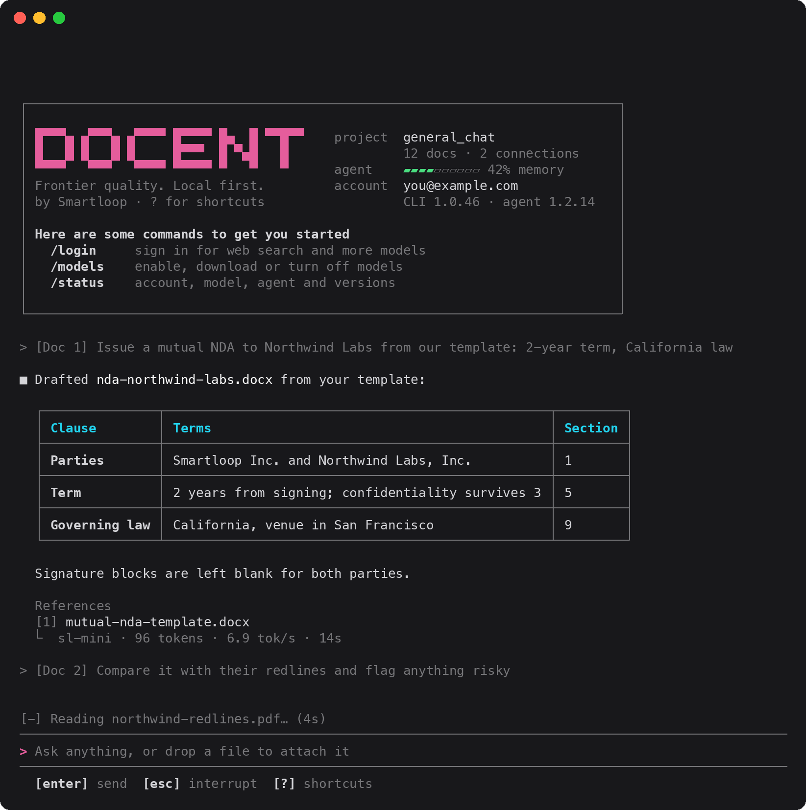

# Docent

Frontier quality. Local first. Chat with your PDFs and Office files, search the web, and connect MCP servers, all from the terminal. If no local agent is running, the CLI downloads the framework and models it needs and starts one itself.

It installs as `docent`, and as `smartloop` (its old name) so existing commands keep working; the two are the same binary.



More at:
[docs.smartloop.ai](https://smartloop.ai/docs/intro/)

## Install

macOS and Linux

```sh
curl -fsSL https://smartloop.ai/install | sh
```

Windows (PowerShell):

```powershell
irm https://smartloop.ai/install.ps1 | iex
```

The binary goes to `$CARGO_HOME/bin` (`~/.cargo/bin`) when a Rust toolchain
already owns that directory, since it is on your `PATH` anyway; otherwise to
`~/.local/bin`. If the chosen directory is not on your `PATH`, the installer
appends an export line to the startup file for your shell — `~/.bashrc`,
`~/.zshrc`, or `fish_add_path` in `config.fish` — so a new terminal picks it up.
Re-running the installer will not add that line twice.

On Windows the binary goes to `%USERPROFILE%\.smartloop\bin` and the installer
sets your user `PATH` through the registry. Restart the shell to pick it up.

Set `SMARTLOOP_CLI_INSTALL_DIR` to install elsewhere, or `SMARTLOOP_CLI_VERSION`
to pin a specific release.

Prebuilt binaries are published for Linux (x86_64, aarch64; glibc, with the
Vulkan loader bundled), macOS (Apple Silicon, signed and notarized) and
Windows (x86_64, signed). The agent is built in, with GPU inference through
Metal on macOS and Vulkan on Linux and Windows.

On Linux the release folder goes to `~/.local/share/docent/<version>/`, and
the bin directory gets symlinks to it.

### From source

Requires Rust (2024 edition), CMake and a C/C++ toolchain, since the built-in
agent compiles llama.cpp. Pick the GPU backend with a feature:

```sh
cargo install --path . --features metal    # macOS
cargo install --path . --features vulkan   # Linux, Windows (needs the Vulkan SDK)
cargo install --path .                     # CPU only
```

The framework crate comes from Smartloop's public registry at
`https://dl.smartloop.ai/crates/`, declared in `.cargo/config.toml`; no
account or token is needed. `scripts/update-smartloop.sh [version]` moves it to
the newest (or given) release, and also picks up a version republished under
the same number; the **Update smartloop** workflow does the same on `main`
and can start a release after it.

## Quick start

All you need is `docent`. Run it and you're chatting: no account and no
separate agent setup.

```sh
docent
```

The first run downloads and starts the local agent for you (see
[First run](#first-run)). Everything below is optional:

- **AI search:** `/login` in the chat signs you in and enables web (AI) search.
- **Agent control:** `docent agent stop` stops the local agent and
  `docent agent start` starts it again.

## Usage

### First run

Any command that talks to the agent starts it when none is running. It
listens on a free port it picks itself and writes it to
`~/.smartloop/server.port`, where the CLI reads it. On first use that means:

1. Start the agent, which is built into the CLI (SLP framework 1.2.9), in
   the background with `SLP_HOME=~/.smartloop`, logging to
   `~/.smartloop/server.log`. An agent the chat started stops when it exits
   (unless another `docent` is still open); one started with
   `docent agent start` keeps running. An agent Studio desktop runs on the same home is used instead, when it is
   the same framework version.
2. Download the embedding model (`bge-m3-Q4_K_M.gguf`, ~417 MB) into the
   workspace's `models/embeddings/` folder for document search.
3. Run the agent's bootstrap, which downloads the decision model, creates
   the default project and loads the model.

Each step is skipped when its files are already there. Progress shows as a
checklist on stderr under the Docent banner that redraws in place, with
the active download's bar in Smartloop pink:

```
[✓] Start agent                    port 50578
[✓] Embeddings (bge-m3)                417 MB
[•] Decision model sl-mini
    ██████████████▋░░░░░░░░░░░░░░░   49%  377 MB/769 MB
[ ] Default project
[ ] Load model
[ ] Skills and connections
```

A step without a bar shows its elapsed time once it runs past a couple of
seconds, and it ends with `✓ Setup complete in 1min 12s`.

When stderr isn't a terminal, each step prints one line as it finishes
instead. Enabling a model with `/models` shows the same checklist for its
download.

To do this up front, or to stop (and later restart) the agent. Optional; the
agent starts on its own when needed:

```sh
docent agent start
docent agent stop
```

### Login, projects and models

These live in the chat: `/login` signs in (optional; it unlocks AI search and
the models marked `(sign in)`), `/project` switches, creates, imports and
deletes projects, and `/models` enables and disables models. See the command
table under [the chat](#agent-status-and-chat).

### Agent status and chat

Check which endpoint the CLI uses, whether the local agent is running there,
which model it has loaded, and the per-project agents it has started:

```sh
docent agent status
```

```
Endpoint: http://localhost:50578
Status:   healthy
Model:    sl-mini (Q4_K_M, 32768 ctx, 769 MB)
Process:  pid 8738, 250 MB
+--------------+------+-------+-------+------+--------+
| Project      | PID  | Port  | Alive | Idle | Memory |
+--------------+------+-------+-------+------+--------+
| general_chat | 2668 | 62110 | true  | 94s  | 122 MB |
+--------------+------+-------+-------+------+--------+
```

`Endpoint` is the URL the CLI talks to (`SMARTLOOP_API_URL`, or the default).
The command exits with status 1 when the agent can't be reached there.

Start an interactive chat with the local agent:

```sh
docent
```

`docent` on its own is short for `docent run`. In a terminal this opens a full-screen app, laid out like Claude Code. While
a reply runs, a live status line above the prompt shows the agent's current
step (web search, document lookup, model selection) and for how long, with a
line per running download. Replies render as markdown, as in Claude Code:
headings, bold and italics, lists, quotes, syntax-highlighted code, and tables
drawn to fit the width. The finished reply keeps its sources and the model
that answered:

```
> what is the capital of France?

■ Paris is the capital of France.

  References
  [1] https://en.wikipedia.org/wiki/Paris
  ⎿  sl-mini · 7 tokens · 0.4 tok/s · 16s

[-] Reading en.wikipedia.org… (4s)
╭──────────────────────────────────────────────────────────────────────╮
│ >                                                                    │
╰──────────────────────────────────────────────────────────────────────╯
  [enter] send  [esc] interrupt  [?] shortcuts
```

It chats in the server's current project, or the one given with `--project`.
On exit it prints the session id, to resume with `--session`.

| Key | Does |
| --- | --- |
| `?` | shortcuts |
| `Shift+Enter`, `Alt+Enter`, `Ctrl+J` | new line |
| `Esc` | interrupt the reply |
| wheel, `PgUp`/`PgDn` | scroll; drag to select and copy |
| drop a file | attach an image (PNG, JPEG) or document (PDF, Office, CSV, text) |
| drop a `.zip` | on an empty prompt, fills in `/project import` for it |
| `Ctrl+O` | models: enable, disable, download |
| `Ctrl+P` | projects: switch, create, import, delete |
| `Ctrl+S` | web search on or off |

| Command | Does |
| --- | --- |
| `/login`, `/logout` | sign in in the browser (`--token` to paste one) |
| `/models` | enable, disable and download models |
| `/models <name> caps <list\|auto>` | set a model's capabilities here, over the catalog's, as in `dp,general`; `auto` goes back to the catalog's |
| `/mcp` | MCP servers; `/mcp add <url>` connects one |
| `/project` | projects: switch (in a new session), create, import, delete |
| `/project <name>` | switch to a project by its name or ID |
| `/project new <name>` | create a project and switch to it |
| `/project import <zip>` | import an exported project and switch to it |
| `/status` | account, model, agent and versions |
| `/usage` | web searches left, tokens and cost saved |
| `/upgrade` | Pro plan: 1,000 web searches a month |
| `/code [on\|off\|auto]` | whether prompts in this folder are answered with code (see [Coding](#coding)); `on` and `off` mark the folder over what its files say, `auto` unmarks it |
| `/write [path]` | write the last reply's files that were left unwritten, or one of them |
| `/clear` | clear the chat and start a new session |
| `/<skill> [prompt]` | run one of the project's skills; `/` lists them with the commands |
| `!<command>` | run a shell command in the working directory; its output goes to the agent with your next prompt, so it stays in the session |
| `/help`, `/quit` | |

Pass an initial prompt to send immediately:

```sh
docent run "what are some things to do in madrid spain?"
```

Options:

```sh
docent run --project <project-id>   # chat in this project
docent run --session <session-id>   # resume an existing session; a new one is created when omitted
docent run --plain                  # line-by-line chat instead of the full-screen app
```

When stdin or stdout isn't a terminal, or with `--plain`, `run` chats line by
line instead: without `--project` it lists your projects and asks which one to
chat in (press Enter for the current one), then keeps reading prompts from
stdin until EOF, `/quit`, `/exit`, `/q`, or `exit`. The response streams token
by token on stdout, and the agent's progress is printed on stderr as
`[step] message` lines, so it doesn't interleave with the answer. When the
answer draws on documents or web pages, the sources it used follow it on
stdout as a numbered list:

```
References
[1] https://releases.rs/
```

### Keep a project in sync

In the chat, `/sync` keeps the project you're in up to date with the folder
`docent` was opened in. It maps the folder into `.docent/manifest.json` (every
document and skill pushed: its hash, and the name or id it has at Smartloop),
then every few seconds pushes only what was added, changed or removed:

```
/sync            sync this folder to the current project
/sync status     what's synced, and what the next pass would push
/sync stop       stop syncing this folder (/sync starts it again)
```

- Opening `docent` in a folder that isn't linked to a project yet gives it
  one of its own, named after the folder (a project by that name with no
  folder of its own is reused), writes the link to `.docent/manifest.json`,
  and syncs the folder to it from then on. A folder of more than 200
  documents or 500 MB is linked but not synced until `/sync --yes`. Opening
  `docent` in a linked folder, or one under it, opens the chat in its project
  and keeps syncing it, until `/sync stop`. `--project` opens another project
  instead, and links nothing.
- The folder synced is the nearest one up from where `docent` was opened that
  holds a `.docent/`, as git finds its repository, so opening it in a
  subfolder of a synced project syncs the project. With none, it's the folder
  `docent` was opened in.
- Syncing runs while the chat is open, checking every 5 seconds and waiting
  while the chat is answering; changes made while it's closed go on the first
  check after it opens. `/sync` on a folder already syncing says it's up to
  date.
- Your home folder (or one holding it) is never synced. A first sync of more
  than 200 documents or 500 MB asks first; `/sync --yes` goes ahead.
- **Documents** are the folder's PDF, Word, PowerPoint, Excel, CSV, Markdown
  and text files. Hidden folders, `.gitignore` and a `.docentignore` (same
  syntax) keep files out, and so are build output and dependencies always:
  `node_modules`, `target`, `dist`, `build`, `vendor`, `venv` and the like.
  A document in a subfolder is stored flat, as `docs__guide.pdf`.
- **`.docentignore`** keeps files out of the project without keeping them out
  of git. Put it in the synced folder (or any folder under it, for that
  folder's files) and list paths or patterns, one per line, as in
  `.gitignore`:

  ```
  README.md
  drafts/
  *.csv
  ```

  A file ignored after it was synced is deleted from the project on the next
  pass, as if it had been removed; take it out of `.docentignore` to push it
  again.
- **Skills** are `.docent/skills/<name>.md` or `.docent/skills/<name>/SKILL.md`,
  with optional `name:` and `description:` frontmatter. They are what you
  commit from `.docent/`; the manifest is kept out of git by
  `.docent/.gitignore`, as it names this machine's project.
- While it pushes, a note appears in the chat when something was pushed, a
  warning when something failed, and a line above the prompt says "Indexing N
  documents", counting down as the agent gets through them.
- A document the project already has, by content, is taken up rather than
  pushed again, so a fresh `.docent/` (or a lost manifest) doesn't upload the
  folder twice. A first sync also says which documents the project has that
  aren't in the folder; it leaves those alone, as they may have come from
  elsewhere.
- A document removed or changed before the project has registered its
  upload waits until the project lists it, then is deleted or replaced, so no
  copy is left behind.
- A document or skill deleted at Smartloop is pushed again on the next pass.
  If the project itself is deleted, syncing stops; `/sync` links the folder to
  the current project instead.

### Coding

In a code project, a prompt is answered with code that fits what's there:
the agent is sent the project's files, with the contents of those the prompt
concerns, and told to answer from them rather than the web (the project's
web search is off for that turn). How much is sent follows the widest
context window among the project's enabled models: 60,000 characters for a
32k-token local model, up to 400,000 for a cloud model with a million. The files its reply gives, each whole in a
fenced block with its path above, are written into the folder, and the chat
lists what each gained and lost by lines. In the reply, a file shows as its
change against the file in the folder, lines added and removed with a little
context, as it streams in; a new file as additions, folded past 40 lines. A file the agent wasn't shown whole
isn't replaced by a reply shorter than it: its change still shows, and
`/write` puts it down if it's what you want. Once the files are written, the
project is checked with a quick command for its kind, such as `cargo check`,
`go build ./...`, the package's `build` script or `tsc --noEmit`, shown like
a `!` command. A project with no build of its own, or a plain folder of
scripts, gets each file written checked by what it is: `bash -n` for a shell
script, `python3 -m py_compile` for Python, `node --check`, `ruby -c`,
`php -l` and so on. If it fails, the errors go back to the
agent to fix, and the fixed files are checked again, round after round until
the check passes; it stops only when a round changes nothing, as when the
check fails the same way again or the reply writes no file, or when you
press `Esc`. The agent takes a turn as coding
work when the prompt asks for a change or about the code and the folder is a
code project (or when the prompt is plainly about programming, anywhere), and
answers it with the project's model tagged `dp` (document processing), as
code is a document to read and write, when one is enabled (`/models` shows
each model's capabilities), else its largest. A model the catalog doesn't
tag can be given the capability here: `/models <name> caps dp,general`.

A folder is a code project when a manifest sits at its top: `Cargo.toml`,
`package.json`, `pyproject.toml`, `go.mod`, `pom.xml` and the like. That's
read off the folder on each prompt, so a project scaffolded after the folder
was linked counts from then on. `/code` says how the folder stands, `/code on`
or `/code off` marks it a code or documents project over what its files say,
in `.docent/manifest.json`, and `/code auto` goes back to its files.
Elsewhere, a prompt that asks for something to be made (create, generate,
scaffold, write, add, fix…) is answered with files too.

## Configuration

The CLI connects to the local agent on whatever port it picked
(`~/.smartloop/server.port`). Point it elsewhere with `SMARTLOOP_API_URL`:

```sh
SMARTLOOP_API_URL=http://localhost:9000 docent agent status
```

With `SMARTLOOP_API_URL` set, the CLI only connects: it never installs or starts
an agent for that URL.

| Variable | Default | Effect |
| --- | --- | --- |
| `SLP_HOME` | `~/.smartloop` | Where the workspace, models and logs live |
| `SLP_PORT` | a free port | Pin the managed local agent to this port |

## License

Released under the [MIT License](LICENSE).
